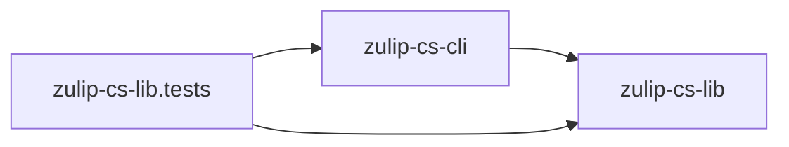

# Dependencies and Build/Test Reference

## Target Frameworks and Language

All projects target:

- `net11.0` (primary)
- `net10.0`
- `net9.0`
- `net8.0`

The repository's `global.json` selects the .NET 11 SDK (11.0.100 or a newer
11.0 feature band). Install the .NET 8, 9, and 10 runtimes as well to run the
tests for all supported targets.

Language version:

- C# `14`

## Project Dependency Graph



## NuGet Dependencies

### `zulip-cs-lib`

- No explicit external NuGet package dependencies.
- Uses .NET BCL APIs including `System.Net.Http` and `System.Text.Json`.

### `zulip-cs-cli`

- `System.CommandLine` `2.*`

### `zulip-cs-lib.tests`

- `Microsoft.NET.Test.Sdk` `18.6.0`
- `Moq` `4.20.72`
- `xunit.v3` `3.*`
- `xunit.runner.visualstudio` `3.1.5`
- `coverlet.collector` `10.0.1`

The test project also references the CLI for offline parser and configuration-discovery tests.

## Version Information in Source

All projects share a single version defined in `src/common.props`:

- Current version: `1.0.0`

The NuGet package includes `LICENSE`, `README.md`, and `CHANGELOG.md`.
Release notes and prerelease migration guidance are in the
[changelog](../CHANGELOG.md).

## Build and Test Commands

Run from the repository root (where `zulip-cs.sln` lives):

```bash
dotnet restore zulip-cs.sln
dotnet build zulip-cs.sln
dotnet test zulip-cs.sln
```

Single test class:

```bash
dotnet test zulip-cs.sln --filter "FullyQualifiedName~zulip_set_lib.tests.IniParserTests"
```

Single fully-qualified test:

```bash
dotnet test zulip-cs.sln --filter "FullyQualifiedName=zulip_set_lib.tests.MessageTests.Message_SendPrivate_EmailSingle"
```

## Runtime and Environment Notes

- CLI requires a valid `zuliprc` file unless custom client construction is used in code.
- Library supports both managed `HttpClient` transport and external `curl` subprocess transport.
- For `curl` backend usage, ensure the executable path is available and accessible.

---
Updated on: 2026-11-13

Documentation version: 1.0.0
