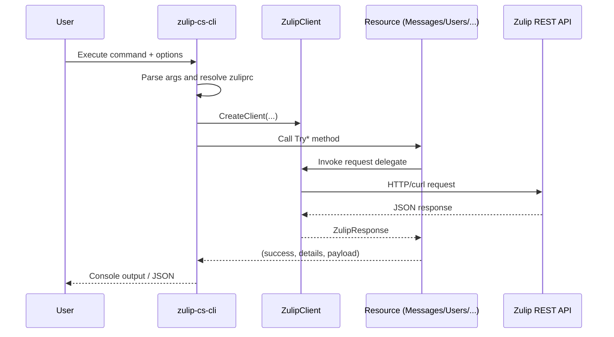
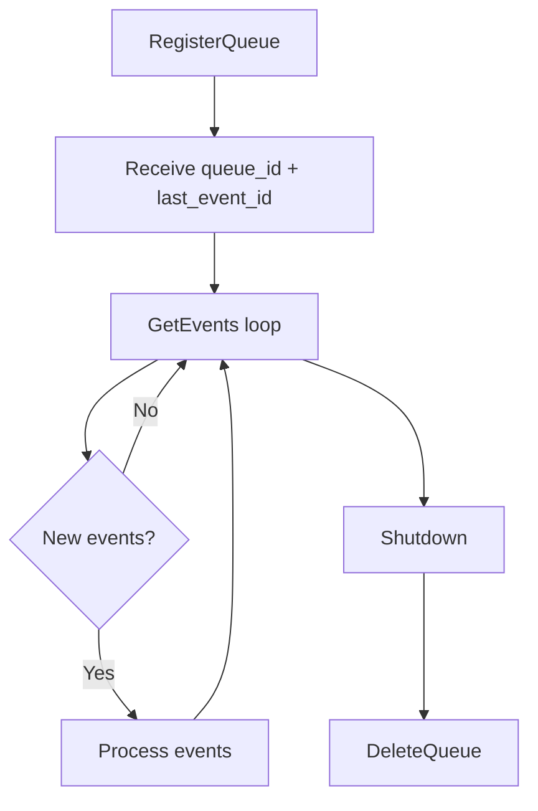

# Process Flows

This document summarizes key execution and interaction flows in `zulip-cs`.

## 1. CLI Command Execution Flow

## 2. Message Send Flow (`Messages.Send*` / `TrySend*`)

1. Caller passes content + recipients (private or stream).
2. Resource validates or structures payload fields (`type`, `to`, `topic`, `content`).
3. Resource sends `POST /api/v1/messages` through delegate.
4. Response is parsed into `ZulipResponse`.
5. Method returns `messageId` (or tuple with failure details).

## 3. Message Retrieval Flow (`Messages.Get`)

1. Caller chooses anchor mode (`Newest`, `Oldest`, `FirstUnread`, `Id`).
2. Optional narrow filters are serialized using `Narrow.ToJsonArray(...)`.
3. Resource issues `GET /api/v1/messages` with `num_before`/`num_after`.
4. Results are returned as `List<MessageObject>` plus anchor boundary metadata in the response envelope.

## 4. Event Queue Lifecycle (`Events`)

Recommended practice: always call `DeleteQueue` on shutdown to clean up server-side queue resources.

Use `Events.Register(RegistrationOptions?)` when initial state, capabilities, timeout metadata or request-local diagnostics are needed. Poll using `registration.LastEventId64`, then pass processed `EventObject.Id` values directly to the long overload. `RegisterQueue` remains the legacy int queue/cursor projection; overflow produces explicit failure with an allocated queue ID that must be cleaned up when unused. Apply the fetched initial state, process events, and only then advance the acknowledged cursor. Common event fields are typed by event kind, while unknown payload fields remain owned JSON. The library does not maintain state or automate retries/continuation.

## 5. Configuration Discovery Flow (`FindZulipRC`)

1. Start at executable base directory.
2. Check `zuliprc` in current directory.
3. Check `secrets/zuliprc` in current directory.
4. Move to parent directory and repeat.
5. Check both candidates at the root, then throw if no config was found.

## 6. Transport Selection Flow

`ZulipClient` binds resources to one transport delegate at construction time:

- `DoZulipRequestHttpClient` when using default/custom `HttpClient`.
- `DoZulipRequestCurl` when using curl backend.

Both return `ZulipResponse`, so resource behavior remains consistent independent of transport.

Ordinary HTTP timeout/cancellation becomes a failed response with fresh diagnostics. Both production backends retain HTTP status/body and reject failed HTTP statuses independently of JSON success; request-local HTTP objects are disposed after materialization.

---
Generated on: 2026-04-07  
Published version: 0.0.1-beta.4
